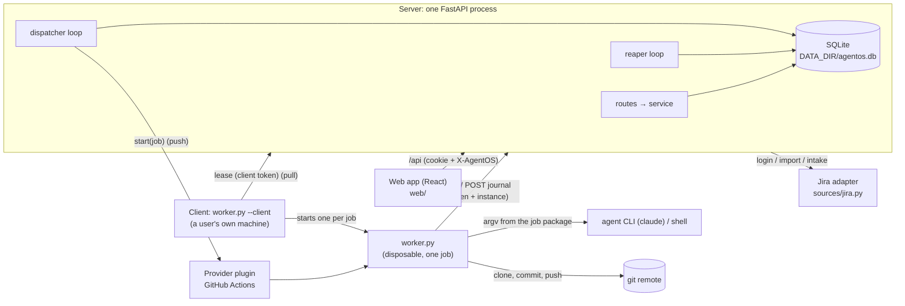

# AgentOS architecture

How the system fits together and why. Each decision is written as **rule**, then the reason, then where it lives. Paths are relative to `backend/server/agentos/` unless they start with `backend/` or `web/`. Where this file and the code disagree, the code is right; fix this file.

## Process & persistence
- **One server process runs the API, the dispatcher and the reaper** (plus the mailbox dispatcher and reaper when a mailbox store is configured). The loops run in the FastAPI lifespan through `_every()`, each tick in a thread. One process means no queue service and no cross-process locking. Where: `main.py` `create_app()`.
- **In production the server also serves the built SPA; in development Vite serves it.** Only when `AGENTOS_WEB_DIR` is set, via a catch-all router registered last, so API routing is unchanged. Where: `spa.py`.
- **SQLite runs in WAL mode with `foreign_keys`, `busy_timeout=5000` and `synchronous=NORMAL`.** Writes use `db.tx()` (BEGIN IMMEDIATE, commit or roll back) and reads use `db.read()` (one query-only snapshot). BEGIN IMMEDIATE serialises writers, so guarded updates never race. Where: `db.py` `_PRAGMAS`, `Database.tx()`, `Database.read()`.
- **Only `db.py` imports `sqlite3`.** A move to Postgres then touches one module. Enforced by import-linter.
- **Migrations are numbered `NNNN_name.sql` files, tracked with `PRAGMA user_version`, and never edited once applied.** Gaps are rejected, a database newer than the code is refused, and an existing database is backed up to `{DATA_DIR}/backups/` (the 5 newest are kept) before migrating. This makes upgrades forward-only with a rollback path. Where: `db.py` `migrations()`, `migrate()`, `backup()`; `migrations/`.
- **Admin-editable settings (Space, repos, intake queries, runtimes, runner, field mappings) live in the `settings` table, one JSON document per area, with a `version` for 409 `stale_version`.** Env vars keep only URLs, secrets, startup/dev config and who may sign in. A fresh database gets every area's built-in defaults at version 1 (`context.seed_settings`). Changing a setting needs no redeploy: nothing caches the settings, each request (and each loop tick) reads the current rows. Where: `migrations/0001_schema.sql`, `space_store.py`, `settings/`.
- **Space, repos, runner, intake queries and field mappings share one versioned-document shape, and the server is the only judge of a value.** GET reads `{value, version, updated_at, updated_by}` (read-only extras beside `value`), PUT saves `{value, base_version}` through one generic save with the stale check written once, and `POST …/validate` runs the same checks without writing (204 or 422), so the web shows problems as the admin types without copying a rule. A 422 lists every problem at its field (`error.issues: [{loc, message}]`), because each area's pure check runs field and cross-field rules in one pass. Runtimes keep their own shape for now; the default workflow is its own call (`POST /api/workflows/{id}/default`). Where: `settings/service.py` `Document`, `pipeline/space.py` / `pipeline/mapping.py` `check_*`, `validate.py` `pydantic_issues`, `http_errors.py`.
- **What stays in env, and why.** Each of these is a deliberate exception to "settings live in the db"; don't move one into Settings without revisiting its reason:
  - `AGENTOS_JIRA_URL`: everyone's Jira token is typed into the login form and sent there. If it were editable in the app, one admin (or one stolen admin session) could point it at their own server and collect every token. It's also needed before anyone can sign in.
  - Secrets (`AGENTOS_JIRA_SERVICE_EMAIL`/`_TOKEN`, `AGENTOS_GITHUB_TOKEN`): in the db they'd be plaintext in the db file and in every automatic backup. Env is how container platforms and secret managers deliver secrets.
  - `AGENTOS_ADMINS`: the first admin (someone must be admin before the app can be configured) and the way back in if every admin is demoted.
  - `AGENTOS_PUBLIC_URL`: decides whether the session cookie is Secure and which origin passes the login checks. Set wrong in the app, it locks everyone out or quietly weakens those checks.
  - `AGENTOS_WORKER_URL`, `AGENTOS_LAUNCHER` (`github`, `mailbox`, or unset = clients only; it sets the server's route), the `AGENTOS_ARTIFACTORY_*` store, `AGENTOS_TRUST_PROXY`: facts about the deployment. A wrong `TRUST_PROXY` lets anyone fake their IP past the login rate limit.

  Where: `config.py` `Settings`.
- **The native key prefix is never one of the Space's Jira projects** (checked both ways on every save). Otherwise native tickets would take keys like `SCRUM-6` that importing the real Jira issue later needs (409 `key_taken`). Where: `pipeline/space.py`, `settings/service.py`.
- **Config is validated at startup, and startup fails fast.** `Settings` uses `extra="forbid"`, so a typo in an `AGENTOS_*` var stops the server. Where: `config.py` `startup_checks()`.

## Data model principles
- **Normalised by default.** Users, identities, sessions, tickets, file versions, runs, stage runs, events and chat each have their own table (`migrations/0001_schema.sql`).
- **Deliberate denormalisations, each with a reason:**
  - `tickets.pipeline` is a JSON copy of the template's pipeline, guarded by `pipeline_version`. Each ticket can enable or disable stages and gates without forking a template. Where: `tickets/service.py` `ticket_pipeline()`.
  - `tickets.tasks_done/tasks_total` are cached from `TASKS.md` on every version write, so lists never parse files. `write_version()` is the one write path, which keeps the cache in step. Where: `files/service.py` `write_version()`, `pipeline/plan.py` `parse_plan()`.
  - `jobs.package` stores exactly the job package built at dispatch, so a run can be inspected (`GET /api/runs/{id}/manifest`, 404 until dispatched), a re-fetch is identical and sync checks paths against it.
  - `runs.journal_seq` is the highest journal seq applied to the run, and `runs.head_commit` the head its worker last pushed (`pushed`).
  - `tickets.pr_url` holds the last PR a worker reported.
- **Some tables are append-only.**
  - `templates`: the current template is `max(version)` per name. A ticket's scaffold is rendered from the current version at creation and never linked afterwards, so a template edit only affects new tickets. Where: `templates/service.py`.
  - `file_versions`: `content = NULL` means deleted, and a write that changes nothing appends nothing. Where: `files/service.py` `write_version()`.
  - `run_events` is keyed by `(run_id, seq)` and inserted `ON CONFLICT DO NOTHING`, so worker retries are safe.
- **Enum columns have no CHECK constraints.** The `Literal`s in `models.py` are the only definition. SQLite can't ALTER a CHECK, so adding a status, source or type would otherwise mean rebuilding a table.
- **Identity is `users` plus `user_identities(provider, subject)`.** A user can have several login providers (dev, Jira, later OIDC or GitHub) without rebuilding `users`.
- **`stage_runs` is keyed by `(run_id, idx)`, not by stage id.** A stage can repeat within a run, which leaves room for future review→fix loops.
- **Adding a feature without breaking the schema:** add the next numbered migration (`0002_….sql` and on) with a new table or a nullable / defaulted column, extend the `Literal` in `models.py`, and never rewrite an applied migration. A board position is derived from run history, never stored.

## Pipeline & segments
- **A pipeline is an ordered list of stages.** A stage is `agent` (a prompt run through a runtime) or `shell` (a command). Each has `enabled`, `gate_after`, a `phase` (plan/build/verify/review) and `requires_repo`. The default template is plan (gated) → implement → lint (off) → review → open-pr. Where: `models.py` `Stage`, `pipeline/scaffold.py` `default_pipeline()`.
- **A run executes one segment:** the enabled stages from `from_stage` up to and including the first `gate_after`, or to the end. Disabled stages, and their gates, are skipped. Where: `pipeline/segment.py` `segment()`, `check_segment()`.
- **When the worker reports `completed`, the run becomes `gated` if the last executed stage has `gate_after` and an enabled stage follows it in the current pipeline. Otherwise it becomes `succeeded`.** Where: `pipeline/segment.py` `completion_status()`.
- **Continue, Retry and Dispatch default to `next_stage()`:** after gated or succeeded, the first enabled stage after the anchor; after failed or cancelled, the failing stage. A ticket is "complete" when no enabled stage follows the last executed one. Where: `tickets/board.py` `next_stage()`.
- **The worker is deliberately dumb.** It executes the job package's stages in order and reports back. All orchestration (segments, gating, the next stage, runtime argv) is pure server functions, which keeps the worker small, stable and testable. Where: `pipeline/` (pure, import-linter enforced).
- **The pipeline is locked while a run is active** (409 `run_active`). Where: `tickets/service.py`.

## Run lifecycle & loops
- **States: `queued → dispatched → running → succeeded | gated | failed | cancelled`.** Every transition is a guarded `UPDATE … WHERE id = ? AND status IN (…)`; zero rows means another actor already moved the run. Where: `runs/service.py`.
- **`finish()` is the only way into a terminal state.** It runs in the caller's transaction, cancels unfinished stage runs, sets `finished_at` and bumps the ticket's `updated_at`. Where: `runs/service.py` `finish()`.
- **Each ticket has at most one active run.** A partial unique index `runs_one_active` covers queued/dispatched/running, and `dispatch()` maps the IntegrityError to 409 `run_active`. One ticket has one branch and one locked bundle, so parallel runs are excluded by design. Where: `migrations/0001_schema.sql`, `runs/service.py` `dispatch()`.
- **The server never starts a worker process.** A worker is started either by a provider (push: GitHub Actions) or by its user's own client, which pulls it (pull: `worker.py --client`). Local work goes only through the personal client. Where: `launchers/`, `clients/`.
- **Every run stores its route at dispatch: `runs.start` (`push | pull`), `runs.provider` (the provider's name; NULL for pull) and `runs.report` (`live | file`).** Dispatch takes `target`:
  - `"server"` (default) stores the server's route, from `AGENTOS_LAUNCHER`: `github` = push + github + live, `mailbox` = push + github + file. Unset, the server has no route and a server dispatch gets 422 `validation_error` at `target` (clients only).
  - `"client"` stores pull + live (`CLIENT_ROUTE`). Only the ticket's owner may target their client (403 `forbidden`, also for an unowned ticket), and only with at least one client token (422 `validation_error`). The web sends `client` only from a click beside the visible choice (the Ticket page header, Run from…); rows always send `server`. The run waits in that user's client queue (`runs.created_by`; changing the owner later doesn't move it).

  Pull + file is never built. A run is dispatched and reaped by its stored route, never by the current settings, so a settings change doesn't strand or fail a queued or running run. Where: `models.py` `Route`, `context.py` `server_route()`, `runs/service.py` `dispatch()`, `CLIENT_ROUTE`, `migrations/0005_routes.sql`.
- **The dispatcher ticks every 2 s.** For each queued push + live run, oldest first, that may start, `mark_next_dispatched` moves it to dispatched and builds its job in the same transaction (a build failure fails the run, which is never started). It then calls its provider's `start(JobStart)` with the job token outside any transaction; a start error fails the run (`launch failed: …`) and marks its job ended. A run whose provider isn't configured (`ctx.providers`) stays queued with a visible `queue_reason` ("its runner (…) is not configured on this server"); dispatch clears it. There is no concurrency limit on our side: the provider queues. The mailbox dispatcher takes the push + file runs the same way. Where: `runs/dispatcher.py` `tick()`, `runs/service.py` `mark_next_dispatched()`, `_next_queued()`, `build_job()`, `fail_start()`.
- **The fence: a ticket's next run stays queued until the previous run's worker can no longer publish.** A queued run is skipped while an earlier run of its ticket has a job with no `jobs.ended_at` whose `not_after` is still ahead; its `queue_reason` says "waiting for run #N's worker to stop". The check is shared by the dispatcher, the mailbox dispatcher and the lease. The reaper stamps `ended_at` on an ended run's job once `job_ended` holds:
  - any route: `not_after` has passed;
  - push: the provider's `status` says `ended`;
  - pull: a later lease by the job's client (`jobs.client_id`) didn't list it in `alive`, or that client has been offline 90 s since the result.

  Without it, a reaped run's worker could still push while its retry starts on the same branch. Where: `runs/service.py` `_SQL_QUEUED`, `_next_queued()`; `runs/reaper.py` `job_ended()`.
- **`not_after` is the latest a job's worker may publish:** dispatch + the start allowance (push: the Space's start timeout; pull: 2 min) + `budget_s` + 15 min (+ 30 min for a file report, the publish job). It is stored on the job and shipped in its package. Where: `runs/service.py` `not_after()`.
- **The lease is the client's hand-off.** `POST /api/worker/lease {wait_s, take, alive}` takes, in one guarded transaction, the oldest unfenced queued client run of the token's user, moves it to dispatched with the client's name as `launch_ref`, builds its job (storing the client as `jobs.client_id`), and answers `{job: {job_id, run_id, server_url, job_token}, protocol, worker_sha256}` (`server_url` is `AGENTOS_PUBLIC_URL`: users' machines reach the server the way browsers do). From there the job's worker speaks the journal like any other. The lease waits up to 25 s for a run: it is `async` and retries the take about once a second through `asyncio.to_thread`, so idle clients hold no threadpool thread; each try reads first and opens the write transaction only when a run is queued, so waiting leases never contend for SQLite's write lock. A client whose slots are all busy sends `take: false` heartbeats (every 30 s) that only record last seen, so it stays online without being handed a run it can't start. Every lease lists the client's running jobs in `alive` (at most 100); the server stamps `jobs.alive_at` on those of the token's user's client runs and ignores other ids. Each take re-checks the token, so a revoke also ends a waiting lease, and a lease whose client disconnects ends at once, so no later run is handed to nobody. A hand-off whose answer never arrives stays dispatched and fails as never started (2 min); nothing re-queues it. Where: `worker_api/routes.py` `lease()`, `worker_api/service.py` `lease_client()`, `take_client_run()`, `runs/service.py` `take_client_run()`.
- **One reaper ticks every 15 s over every job that hasn't ended, keyed on each job's stored route.** Job by job, the first rule that applies wins:

  | # | Rule | When | Then |
  |---|---|---|---|
  | 0 | Sleep grace | the previous tick was over 60 s ago (startup, laptop sleep) | every running run counts as just seen; nothing else that tick |
  | 1 | Start interrupted | push, dispatched, no provider ref after 15 min | failed "start interrupted" |
  | 2 | Never started | dispatched, no `started` past the start timeout (push: the Space's start timeout, `claim_timeout_s`, 1 h by default, and the provider doesn't say running; pull: 2 min after the lease) | failed "never started"; push: stopped `never_started` and cancelled at the provider |
  | 3 | Lost | no journal post for 90 s | failed "worker lost"; push: cancelled at the provider |
  | 4 | Over budget | past `started_at` + `budget_s` + 15 min | stopped `budget` (the worker sees `cancel: true`, publishes, then fails) |
  | 5 | Stop grace | no result 2 min after a stop | ended by the stop table (below); push: cancelled at the provider |

  Within the stop grace a running job is left alone: its worker sees `cancel: true` and still syncs, commits and publishes, so the provider is asked to cancel a running job only by rules 3 and 5 (and a push run cancelled while queued or dispatched once it is). Each provider cancel is asked once per job, best effort, and a push job's status is polled at most every 60 s. File-report runs get rule 1 only: the mailbox reaper watches them, and with no mailbox store configured one past its `not_after` fails ("its runner is no longer configured"). No rule touches a queued run, so a client run waits however long its user's client is offline (cancel still works). Nothing stays running forever, and sleep or restarts don't kill healthy runs. A job whose check raises is logged and the next one is checked. Where: `runs/reaper.py` `judge()`, `Reaper.tick()` (docstring and constants), `runs/service.py` `reap()`, `active_jobs()`.
- **Stops:** `stop_requested_at` and `stop_reason` (`cancel | budget | never_started`), on the run and on its job, record that the server asked a worker to stop. A queued or dispatched run is cancelled at once; a running one is stopped with reason `cancel`, and the worker sees `cancel: true` in its next journal answer. A stopped job that reports `cancelled` (or reaches the stop grace) ends as the stop table `STOPPED` says: `cancel` → cancelled; `budget` → failed "time budget exceeded"; `never_started` → failed "never started". The UI shows the reason. Where: `runs/service.py` `cancel()`, `stop()`, `STOPPED`, `worker_api/service.py` `ingest()`.

## Server ↔ worker protocol
- **A run has one job (`jobs`, id `<run_id>-1-<16 hex>`), built when the run is dispatched: its package and one job token.** The job token (`token_urlsafe(32)`) goes to the provider's `start`, or to the client in the lease answer; a mailbox job's is never kept. Only its SHA-256 digest is stored (`jobs.token_hash`), never cleared, because a token's validity follows the run's status. This keeps plaintext out of storage and matters because GitHub workflow inputs are visible to repo readers. Where: `runs/service.py` `build_job()`.
- **Binding:** each worker process makes up an instance id and sends it as `X-AgentOS-Instance` on every request. The first accepted `started` record binds the job to it (`jobs.instance_hash`) and moves the run `dispatched → running`; from then on only that instance may report. The worker routes answer:

  | Situation | `GET /api/worker/job` | `POST /api/worker/journal` |
  |---|---|---|
  | unknown job token | 401 | 401 |
  | dispatched, unbound | 200, the stored package | the first new record must be a valid `started` at `journal_seq + 1` (else 422 `validation_error`, nothing bound; no instance header: 401), then it binds |
  | bound to this instance | 200 | 200, ingested |
  | bound to another instance, or started by the server (mailbox) | 409 `already_claimed` | 409 `already_claimed` |
  | terminal run | 410 `run_gone` | 410, except a batch that ends in a `result` matching the run's final status with nothing new before it (a worker whose last answer was lost): 200. An older batch resent without its `result` gets 410, so its worker stops before committing or pushing |

  The sync_back upload checks the same before reading its body, plus 404 for another job's id and 410 unless running. A `started` from another `worker_sha256` still binds, with a warning. Where: `worker_api/service.py` `_job_run()`, `job_package()`, `post_journal()`, `check_upload()`, `_FINAL`.
- **The journal is the only way results reach the server:** one ordered list of records per run, `{seq, ts, job, type, stage_id, data}`, numbered by the worker from the job's `journal.first_seq` (its `started`) across every type. `POST /api/worker/journal {records}` (at most 500) answers `{ack, cancel, rejected}`: `ack` is the run's highest applied seq, `cancel` mirrors `stop_requested_at`, `rejected` lists the batch's records that were consumed without applying. An empty batch is the heartbeat (at least every 10 s); every post refreshes `last_seen_at`. Record types:
  - `started` `{protocol, worker_sha256}`: binds (above).
  - Display records `stage_started`, `stage_finished`, `log`, `warning`, `verdict`, `verdict_repair` (exactly `RunEvent`): stored as `run_events` rows at their own seq, moving stage_runs along; the first `stage_started` locks the base branch. The server never numbers a row; past 100,000 events it drops `log`s (the worker's own cap comes first).
  - `sync` `{files}` and `sync_back` `{sha256, bytes, files}`: below.
  - `pushed` `{branch, head, commits, method}`: stores `runs.head_commit`.
  - `result` `{status, failed_stage, error, pr_url}`: ends the run through `finish()` (`completed` → gated or succeeded) and stores a valid `pr_url` on the ticket.
- **One `ingest()` applies records in strict seq order.** A seq at or below `journal_seq` is a duplicate and skipped, `journal_seq + 1` is applied, and a gap stops the batch (`ack` says where to resend from). `runs.journal_seq` is written in the same transaction as the effects, so a batch commits whole or not at all, and a resend after a lost reply changes nothing. Nothing after a `result` applies. A record that can't apply (bad data, another job, an unknown type, a refused sync path, an unverified sync_back) is consumed: a `warning` row at its seq says why, it is listed in `rejected`, and it is logged. Per-record problems never fail the batch. Where: `worker_api/service.py` `ingest()`, `_apply()`, `_store_events()`.
- **The job package (protocol 2) is all the worker knows of a run.** Fields: `protocol: 2`, `job {id, run_id, segment, segments, budget_s, not_after}`, `journal {first_seq}`, `report {mode: live | file, url}`, `run_id`, `ticket {key, title}`, `workspace {mode, repo_url, base_branch, branch, protect, blocks}`, `context`, `notes`, `sync_back {dir, max_bytes}`, `env` (workspace-relative `AGENTOS_SKILL_DIR` and `AGENTOS_SYNC_BACK`; the worker adds `AGENTOS_RUN_ID` and `AGENTOS_TICKET_KEY`), `stages`, `loops`, `start_stage`, `warnings` and `limits {max_file_bytes, max_line_bytes}`. The worker refuses any other protocol and exits before binding, so the run fails as never started. Up front it checks only the protocol and the loop shape; the repo URL and branches are checked at workspace setup and paths when they are written (`resolve_inside`), so the worker keeps no copy of the server's models. Where: `models.py` `JobPackage`, `pipeline/manifest.py` `build_package()`, `worker.py` `load_package()`.
- **Every ticket file is a typed `context` entry** `{path, kind, name, mode, block, access, content}`. The kind comes from the path, first match wins: the ticket skill's `TASKS.md` → `plan`; a block-mode file → `instructions` (`block` = the ticket key); `.claude/agents/**` → `agent`; other files in `.claude/skills/<n>/` → `skill` named `<n>` (the ticket skill's old `out/` files excepted); anything else → `file`. Every ticket file is `access: write`; `read` entries are never synced. The kind says what a file is, so neither the worker nor the UI guesses from a path. Where: `pipeline/manifest.py` `classify()`.
- **Notes** (the ticket skill's `learnings.log` and `swarm.log`) go in `notes` and are shipped and synced like write context. Append-only is warn-only: a note that no longer starts with its shipped content gets one warning per run and is still stored. Where: `worker.py` `SyncState`.
- **Sync** (a `sync` record after every stage) is declared-only, because returning anything is deliberate: an agent's build output can never become ticket context.
  - After each stage the worker reads exactly the write context entries and the notes and sends those that changed since it last sent them: a deleted replace file as `content: null`, a block file as its block only. There is no directory walk.
  - The server writes a path, as a version authored by the run, only if it matches (by `path_key`, in the same mode) a write context entry or note of the job's package. Any other path is refused: the rest of the record still applies, and the record is rejected with a warning naming the refused paths. A `stage_id` outside the run rejects it too.
  - Files under `workspace.protect` (the ticket skill dir) that aren't declared are neither synced nor committed: one warning per stage names them (`not kept: …`, at most 20 names plus a count).

  Where: `worker_api/service.py` `_sync()`, `worker.py` `SyncState`.
- **sync_back is the one way to return anything else.** The folder is `.agentos/sync_back/` in the workspace, in both modes; prompts name it `{{paths.sync_back}}`, stages get `AGENTOS_SYNC_BACK`, and the scaffold's AGENTS.md block points agents there.
  - At the end of the job (completed, failed or cancelled, once setup finished, before the `result` and before the workdir is deleted) the worker zips its regular files with stdlib `zipfile`. Links and special files are skipped and named in a warning; an empty folder sends nothing; a zip over `sync_back.max_bytes` (20 MiB compressed, `validate.MAX_SYNC_BACK_BYTES`) gets a warning and isn't sent.
  - Upload: one `PUT /api/worker/jobs/{job id}/sync-back?sha256=…&files=N` with the job token and instance, for a running run only, then a `sync_back` record describing it. The server stops reading past the cap (413 `too_large`), checks the sha256 (422) and upserts the zip into `run_sync_back` (one row per run, so a retry replaces it; deleted with the run). The record must match the stored zip's sha256, bytes and files; otherwise it is rejected and the zip deleted. It's an opaque blob: never extracted, never ticket context. An upload error other than 401/410 only warns (and sends no record), and the run completes as usual.
  - Download: `RunDetail.sync_back {files, bytes}` drives the Runs tab line ("sync_back.zip · N files · size"), which links `GET /api/runs/{id}/sync-back` (any approved user; `application/zip` as an attachment; 404 when there is none).
  - Mailbox mode doesn't return it yet: a non-empty folder gets one warning.

  Where: `worker.py` `Run._send_sync_back()`, `worker_api/routes.py` `job_sync_back()`, `worker_api/service.py` `store_sync_back()`, `migrations/0003_run_sync_back.sql`, `runs/routes.py` `get_sync_back()`, `web/src/features/runs/RunsTab.tsx`.
- **The worker reports through a `Reporter`** (a `typing.Protocol`: `send(records) -> Ack`, `close()`): `HttpReporter` posts the journal in live mode, `Recorder` writes the mailbox outbox. `EventSink` numbers the records, batches them (every second, at 200, and a heartbeat at least every 10 s) and keeps each until it is acked, so every send starts at `ack + 1` with the same instance, and a reconnect resends what the server didn't apply. `Run` never calls the server itself: sync, sync_back, pushed and result are records (only the sync_back zip is a PUT of its own).
- **Bind first:** the worker fetches its job (`GET /api/worker/job`), posts `started` and waits for its ack before it touches the workdir. 409 there exits 0 (another instance holds the job); 401/410, or a package it can't use, exits 1. It publishes nothing after the job's `not_after` (above), in live and file mode alike.
- **Failure semantics in the worker:**
  - 401/409/410 on any post → kill the stage process tree, no commit, no push, exit 1. A reaped run's worker must not race its retry on the branch.
  - Server unreachable (network errors or 5xx for 300 s, or any other 4xx on the journal, since the server would wait forever at the gap a dropped batch leaves) → kill the stage tree, commit and push what exists, exit 1. The reaper then fails the run.
  - Cancel → kill the stage tree, still sync, commit and push, then a `cancelled` result.
  - Over budget (the job's `budget_s` has passed since binding; checked during each stage, before each stage and in the repair loop) → the same, then a `failed` result "time budget exceeded".
  - `not_after` passed before a publish → like 401/410: nothing is published, exit 1.
  - Result rejected (its seq in an answer's `rejected`: the server consumed it without ending the run) → a failure to complete: nothing more is published, the workdir is kept, exit 1. The reaper then fails the run.

  Where: `backend/worker/worker.py` module docstring, `HttpReporter`, `EventSink`, `RunGone`, `AlreadyClaimed`, `ResultRejected`, `Unreachable`, `RETRY_BUDGET_S`.
- **`worker.py` is one stdlib-only file (Python ≥ 3.11), served publicly at `GET /api/worker/worker.py`.** Runners install nothing, and the worker always matches the server's version. The exception is a client: it runs its own local copy (and starts that copy for each run), never one fetched from the server, so its user updates it along with the server; there is no version check. Worker routes skip CSRF because they use bearer tokens, not cookies. Where: `worker_api/routes.py`, `csrf.py`, `backend/worker/worker_tests/test_worker_stdlib.py`.

## Context files & git safety
- **A ticket's context is a versioned file bundle.** By default it holds `.claude/skills/context-<key>/` (`SKILL.md`, `TASKS.md`, `learnings.log`, `swarm.log`) plus `AGENTS.md` and `CLAUDE.md` in block mode. Agents get context as files, the convention they already understand. Where: `pipeline/scaffold.py`.
- **The job package is built and stored when the run is dispatched, not when it is queued.** A queued run never ships stale context. At the same moment, the repo URL and branch are resolved from the Space's catalog and the default runtime and model from the current template. A build failure (a repo gone from the catalog, a changed pipeline) fails the run, which is never started. Where: `runs/service.py` `build_job()`, `pipeline/manifest.py` `build_package()`.
- **The bundle is read-only (409 `bundle_locked`) from a run's dispatch until it ends,** because its package is built then. A queued server run doesn't lock it. A client run locks it already while queued: it will run on its owner's machine with the owner's credentials, so only what the owner dispatched may reach it. For the same reason a PATCH of the ticket's owner, title, description or type (the fields its prompts render) gets 409 `run_active` while one waits (queued or dispatched). Where: `files/service.py` `_check_unlocked()`, `tickets/service.py` `patch_ticket()`, `clients/service.py` `waiting_client_run_id()`.
- **Block mode:** the server's content goes between `<!-- agentos:begin KEY -->` and `<!-- agentos:end KEY -->` inside a file the repo may already have. The rest of the repo's copy survives, and blocks are never stripped. Where: `worker.py` `block_markers()` / `block_write()` / `block_read()` (the worker writes the markers), and `validate.py` `MARKER_RE` (block content can't contain a marker line).
- **A shipped agent never overwrites the repo's.** If a `kind: agent` entry's path already exists after the clone (tracked or untracked), setup fails with an error naming the file, before any context file is written; nothing is committed or pushed. Where: `worker.py` `Run._execute()`.
- **`.agentos/` in the workspace belongs to AgentOS** (a check's `verdict.json`, the sync_back folder): it is never synced as context and never committed.
- **Git protection has several layers, so it holds even if the agent commits by itself or `.gitignore` has negations.** Context paths are every declared entry and note, every folder in `workspace.protect`, and `.agentos/`.
  - `skip-worktree` on tracked context paths.
  - `.git/info/exclude` for untracked context paths and tool caches (`JUNK_PATTERNS`).
  - Unstage-and-assert after `git add -A`.
  - A pre-push guard that rejects commits touching context paths or containing an `agentos:begin` marker for any name in `workspace.blocks`.
  - A `pre-push` hook (local `core.hooksPath` under `.git/`, so a global hooksPath can't skip it) refuses every push but the worker's own: only the worker's git gets the per-run marker, stage processes never do. A publish rejected because the branch moved says "the branch moved during the stage; did the agent push?".
  - Never a force push. On GitHub Actions (`GITHUB_ACTIONS=true` with `GH_TOKEN`) `_push()` publishes through the Git Data API instead of `git push`, as one commit per publish, with `force: false` on the ref write; an agent's rewrite of published commits or a merge is refused.

  The cost: an agent's edits to a tracked `AGENTS.md` outside the block aren't committed. Where: `worker.py` `_commit()`, `_guard()`, `_push()`.
- **The worker commits and pushes after every stage.** Progress survives crashes, and the open-pr stage needs the branch on the remote. Its branch is `agent/<KEY>`.

## Board model
- **The server derives every board field, and the UI never derives state.** `derive(facts) -> TicketBoard` is viewer-independent: phase, phase track, rail (every stage, disabled ones as `skipped`, with gate info), `attention_since`, `next_stage`, `now`. `for_viewer(board, viewer_id) -> ViewerBoard` then adds attention (`needs_you | waiting | running | queued | blocked | inbox | done`) and the gate state for that viewer. List endpoints batch-load facts once and only the cheap per-viewer step varies. One definition for every state means three board layouts can't disagree. Where: `tickets/board.py` (pure).
- **No presence indicators; one optional owner.** `needs_you` means you own the ticket or nobody does. Presence makes people feel watched. A client's online state (a token that leased within `clients.service.ONLINE_WINDOW`, 60 s) is not presence: it describes a machine, and the UI shows it only where a client run's start depends on it (`RunSummary.client_online`; the now line "waiting for <name>'s client", then "starting on <name>'s client" once taken).

## Auth & security
- **Roles: `pending < viewer < writer < admin`.** A first Jira login is `pending` and gets 403 `pending_approval` everywhere except `GET /api/me` until an admin approves it. Where: `models.py` `Role`, `auth/deps.py`.
- **Jira login:** credentials are checked against Jira and never stored. Access needs browse rights on one of the Space's Jira projects (`GET /rest/api/2/project/{key}`). Admins are matched on the `/myself` profile against `AGENTOS_ADMINS`, never on request input. They skip the project check, so a bad Settings › Space save can't lock them out; with no projects set, only they can sign in. Where: `auth/service.py`, `sources/jira.py`.
- **Sessions last 14 days; only token hashes are stored.** Cookies are HttpOnly, SameSite=Lax, and Secure when the public URL is https. Where: `auth/service.py` `SESSION_TTL`, `cookie_secure()`.
- **CSRF:** every non-GET `/api` request (except `/api/worker/*`) must send `X-AgentOS: 1`, and CORS is off. A custom header can't be sent cross-origin without a preflight. Where: `csrf.py`, `web/src/api/client.ts`.
- **Client tokens are personal access tokens for a user's own client.** A writer creates one in Settings › My client (`POST /api/me/clients`, cookie + CSRF); its plaintext is in that answer only, and only its SHA-256 digest is stored. Any approved user lists and revokes their own (`GET`, `DELETE /api/me/clients/{id}`); revoking deletes the row. The client sends it as a bearer to `POST /api/worker/lease` only, which is CSRF-exempt by the `/api/worker/` prefix like every bearer route. An unknown or revoked token, or a disabled or pending user, gets 401; below writer gets 403 `forbidden`. A token reaches only runs its own user dispatched to their client, and each run's worker then holds that run's own job token, so runs a revoked client started still finish. There is no admin view of other users' tokens; disabling a user cuts theirs off. Where: `clients/`, the `client_tokens` table in `migrations/0001_schema.sql`.
- **Dev auth (any username, always admin) only works on loopback.** It is checked at startup against `AGENTOS_HOST` and `AGENTOS_PUBLIC_URL`, and per request against the client address. Where: `config.py` `startup_checks()`, `auth/service.py` `_dev_login()`.
- **A client's `--workdir-root` must be outside any git repo** (it refuses to start otherwise). Otherwise a parent `CLAUDE.md`/`AGENTS.md` leaks into agents. The server keeps no workspaces. Where: `backend/worker/worker.py` `run_client()`.
- **Imported ticket text is untrusted prompt input.** Intake never dispatches by itself.
- **The server never runs git.** Clone, commit and push happen on the worker with the runner's credentials: the job's `GITHUB_TOKEN` on Actions, or the user's own credentials (plus the client's `--env-file`) on a client. The server's own GitHub token can only dispatch the workflow. The worker uses the job's `GITHUB_TOKEN`, not a GitHub App installation token, on purpose: App tokens expire after an hour, and the worker pushes after every stage of runs that can last much longer. The cost: PRs it opens don't trigger other workflows.

## Plugins
- **A provider starts, watches and stops a push job's worker: `start(JobStart) -> ref`, `status(ref) -> JobStatus`, `cancel(ref)`, `cleanup(ref)`** (a `typing.Protocol`). `JobStart` carries the job id, run id, server URL and job token; `JobStatus.state` is `pending | running | ended | unknown` and describes the worker's job, never a whole workflow run. Errors are `ProviderError`s with safe messages. Providers have no database access and no concurrency limit (the provider queues), so a fork can add one without knowing the schema. `AppContext.providers` maps each configured provider's name (the one a route stores) to it. Where: `launchers/base.py`, `context.py`.
  - `github` (`GitHubActionsProvider`): one workflow dispatch per job, with the workflow's inputs `server`, `token`, `run_id`; the ref is the Actions run URL. `status` reads the run's jobs list and judges the `work` job: queued, waiting, pending or requested → pending, else running; `ended` only once every job of the run has completed (a mailbox publish job may still be uploading after work); a ref that names no run of the current target repo → unknown. `cancel` treats 202 and 409 as done; `cleanup` does nothing. The repo, workflow and ref come from Settings, and `backend/deploy/github/agentos-worker.yml` must stay identical to `.github/workflows/agentos-worker.yml` (a test checks this). Where: `launchers/github.py`.
  - `mailbox` (push + github + file): for runners that can reach GitHub and a store (Artifactory) but not the server. One package in, one package out:
    - **Selected by stored route:** the mailbox dispatcher and reaper run whenever a mailbox store is configured (`Settings.mailbox_store`), the dispatcher takes only `report = 'file'` runs, the reaper watches only running ones, and the runs dispatcher never takes them.
    - **Launch:** the server dispatches the run with a file-report job (`report.mode: file`, no token kept) and starts it itself (`dispatched → running`, no instance binds). It uploads the package (as `manifest.json`) and `worker.py` to `runs/<run id>-<the job id's 16 hex>/` in the store and dispatches `agentos-mailbox.yml` through the github provider's `dispatch()` (inputs `run`, `worker_sha256`, `manifest_sha256`).
    - **Three jobs:** fetch (holds the store secret) → work (runs the agent; no store secret, so the agent can never read it) → publish (holds the store secret again; uploads the outbox bytes without parsing them).
    - **The outbox** is the worker's journal recorded as worker API calls, one per line (`worker.py --manifest --outbox`; `Recorder`: events, sync and complete calls; `started`, `pushed` and `sync_back` aren't written). The server replays it through `ingest()`: each line becomes journal records (events → display records, sync → `sync`, complete → `result`), numbered in line order from the job's `first_seq` (the one place the server numbers records), one transaction per line, so a replay after a crash skips what was applied. The state machine, board and UI are shared with HTTP mode; unknown or invalid lines are skipped and logged, rejected records and sync refusals are logged, and sync_back isn't returned yet.
    - **Liveness** comes from the provider's job-level `JobStatus`, not heartbeats. The runs reaper gives file runs rule 1 only, and the mailbox reaper applies its own rules (its docstring), cancelling the Actions run through the API: ended without an outbox → failed (cancelled if stopped); the work job still pending past the start timeout → never started (unknown never triggers it, and a finished work job whose publish job waits is not pending); past `not_after` → failed; a stop GitHub can't confirm (status unknown) → cancelled after 15 min.
    - **Results arrive when the GitHub job ends**; to watch a run live, open it on GitHub.
    - **Cleanup:** the run folder is deleted after replay, and an hourly sweep removes folders of runs that are no longer active.
    - **Where:** `launchers/mailbox.py`, `stores/`, `mailbox/`; the design is in `design/mailbox.md` (local).
    - **Long term** this is meant to become the only worker protocol, and the HTTP worker path will be deleted.
- **Beside the server's route, users' clients pull their own runs (pull + live), and this is the only way to run work locally.** A client is not a provider: the server never starts it, so the dispatcher has nothing to call. A user runs `worker.py --client` on their own machine (stdlib only, like the worker). It leases with its client token (listing its running children's job ids as `alive`), and for each job it gets it starts the worker in HTTP mode as a detached child: its own process group (on Windows `CREATE_NEW_PROCESS_GROUP | CREATE_NO_WINDOW`, so a Ctrl+C in the client's console doesn't kill runs), its environment minus `AGENTOS_*` plus `--env-file` and the job token as `AGENTOS_TOKEN` (never on argv), a workspace in its own `runs/` folder under `--workdir-root` (outside any git repo; the 7-day cleanup looks nowhere else), up to `--max-runs` at once. It keeps leasing through an unreachable server and stops on any 4xx but a transient one (401/403 included) and on another `protocol` in the lease answer, so a protocol change doesn't make it retry forever; a different `worker_sha256` is mentioned once. Runs then use the user's own agent login and git credentials, and the server's route keeps serving every other run. Where: `clients/`, `backend/worker/worker.py` `run_client()`; setup in `backend/deploy/README.md`.
- **Jira is one HTTP adapter that login, import and intake call directly.** There is no ticket-source protocol; like a plugin, the adapter has no db, service or FastAPI access, and it raises its own `JiraError`s, which the services map to `ApiError`. Where: `sources/jira.py`.
  - Jira Cloud has removed `/rest/api/2/search`, so search uses `POST /rest/api/3/search/jql`, which has no total (`/search/approximate-count` estimates it). Cloud answers an unknown field, project or value with an empty result rather than a 400, so an empty answer is explained via `/rest/api/3/jql/parse`. Data Center still uses `/rest/api/2/search`.
- **Runtimes are argv templates resolved on the server.** Placeholders (`{model}`, `{agent}`, `{prompt}`) replace whole argv elements, with no shell involved. The worker knows nothing about runtimes, so switching CLIs (e.g. Copilot) is a settings change. Where: `pipeline/runtime.py`, `pipeline/manifest.py`; edited in Settings › Runners.

## Frontend
- **TanStack Query is the only store for server state.** There is no global store, no component library, and no markdown or diff library. Runtime dependencies are React, react-query, openapi-fetch, react-router and the Geist fonts. Where: `web/package.json`.
- **Components reach the server only through hooks in `web/src/api/queries.ts`,** which own one hierarchical query-key factory. ESLint forbids importing `api`/`unwrap` elsewhere. Where: `web/eslint.config.js`.
- **API types are generated** (`openapi.json` → `schema.ts` via `just gen-api`). The frontend never edits them.
- **Layers:** `app/` (router, providers, shell), `features/` (one folder per view), `ui/` (kit primitives), `editor/` (the editor kit), `domain/` (pure selection over server fields: counts, groups, words; it never invents a state), `styles/` (tokens).
- **Every view reads a ticket through one view-model and draws it with one kit.** `domain/ticketView.ts` (with `plan.ts` and `format.ts`) gives the run line, gate, stage count, status and durations, so My queue, Compact, the peek and the Ticket page show the same strings for the same ticket; `ui/` holds the shared primitives (Dialog, the DataList parts, EmptyState, Badge, Stack/Inline…), and feature CSS keeps only layout grids and the visuals no other view shares. Where: `web/src/domain/`, `web/src/ui/`, `web/AGENTS.md`.
- **Editable pages share one editor kit (`web/src/editor/`), outside any feature.** `useDocument` holds a versioned document's draft, base version, save, conflict reload and the server's issues; `DocumentPage` draws the loading, admins-only and error states and the page's one leave warning; `ListEditor` draws keyed rows (add, remove, move, expand, live preview); the issues module places a 422's issues on their fields, list indices mapped to row keys. Each editor then writes only its fields, and every one saves, conflicts and reports problems the same way. The kit never imports `features/`, `app/` or `api/queries.ts`: pages pass their queries in. Where: `web/src/editor/`, `web/AGENTS.md`.
- **Spacing uses the `--sp-*` tokens, and a static check enforces it.** One scale keeps views consistent, and review alone lets raw pixels creep back. `npm run check:spacing` (in `npm run check`) fails on a raw length in a CSS module's margin, padding or gap, except for a short allowlist with a reason per entry. Where: `web/src/styles/tokens.css`, `web/scripts/check-spacing.ts`.
- **Live updates come from polling** (3 s for lists, 1 s for an active run). TanStack pauses it in background tabs. Where: `web/src/api/queries.ts`.

## Enforcement
- **import-linter** (`backend/pyproject.toml`, 7 contracts):
  1. The pure core (`models`, `validate`, `pipeline`, `*.board`) imports no web, db, HTTP client or config.
  2. Inside a feature, the layers run `routes → deps → loops → service → board`.
  3. Routes, deps and `meta` reach the database only through services.
  4. Only `agentos.db` imports `sqlite3`.
  5. Only the HTTP layer imports FastAPI/Starlette/uvicorn; services raise the pure `ApiError`, which `http_errors.py` translates.
  6. Plugins (`launchers`, `sources`, `stores`) import no db, services, routes or FastAPI.
  7. There are no import cycles between subpackages. The direction is `worker_api → runs → social → tickets → workflows → templates | files | clients → auth`; `clients` is a leaf (its tokens, who is online, and a ticket's waiting client run).
- **Drift test:** `server/tests/test_api_drift.py` fails when the committed `web/src/api/openapi.json` doesn't match the backend.
- **Shared fixtures:** `server/tests/fixtures/job_v2.json` is the server ↔ worker contract (a protocol 2 job package): the server suite validates it as `JobPackage` and compares its keys with `build_package()`, and the worker suite loads it with `load_package()`. `fixtures/journal_v2.jsonl` holds one journal record per type: the server suite validates and ingests it, and the worker suite checks the records it emits have the same keys. `fixtures/path_cases.json` is one table of path rules, run against both `validate.validate_path` and `worker.path_error`.
- **The worker on Python 3.11:** `check-backend` type-checks `worker.py` as 3.11, and `test_worker_stdlib.py` forbids non-stdlib imports.
- **Closed error codes:** `models.ErrorCode` is the full set, and the UI branches on them (e.g. 409 `stale_version` / `run_active` / `bundle_locked`).

## Planned, not built
- Jira comments and comment sync: write-back will be official comments only (a resolve note is a candidate), with no status transitions. **Talk is never synced to Jira.**
- Intake auto take-in: a per-query `auto_take_in`, **off by default**. Tickets it imports have no owner, and Intake still never dispatches.
- Teams, edited in Settings › Teams, with Jira's team field mapped to `ticket.team_id`. Everyone in the Space sees every ticket, and My queue stays personal. All teams groups by team, or by repo when no teams are set up.
- Fetch and publish workspace hooks supplied by the runner environment.
- `CodeHost.find_pr`; today the worker runs `gh pr view`.
- GitHub Issues and Todoist sources; validation of the Copilot runtime; workspace snapshots for no-repo tickets.
- Human stages, approvers, review→fix loops, `Stage.when` conditions.
- OIDC/SSO login; GitHub OIDC for binding a job.
- Postgres behind `db.py`.

## Never
- Presence indicators.
- Parallel stages, or parallel runs, within a ticket.
- Storing users' Jira tokens on the server.
- A worker that pushes after 401/410, or any force push.
