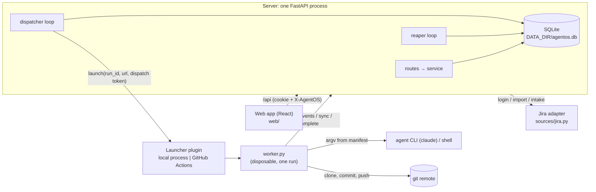

# AgentOS architecture

How the system fits together and why. Each decision is written as **rule**, then the reason, then where it lives. Paths are relative to `backend/server/agentos/` unless they start with `backend/` or `web/`. Where this file and the code disagree, the code is right; fix this file.

## Process & persistence
- **One server process runs the API, the dispatcher and the reaper.** The two loops run in the FastAPI lifespan through `_every()`, each tick in a thread. One process means no queue service and no cross-process locking. Where: `main.py` `create_app()`.
- **In production the server also serves the built SPA; in development Vite serves it.** Only when `AGENTOS_WEB_DIR` is set, via a catch-all router registered last, so API routing is unchanged. Where: `spa.py`.
- **SQLite runs in WAL mode with `foreign_keys`, `busy_timeout=5000` and `synchronous=NORMAL`.** Writes use `db.tx()` (BEGIN IMMEDIATE, commit or roll back) and reads use `db.read()` (one query-only snapshot). BEGIN IMMEDIATE serialises writers, so guarded updates never race. Where: `db.py` `_PRAGMAS`, `Database.tx()`, `Database.read()`.
- **Only `db.py` imports `sqlite3`.** A move to Postgres then touches one module. Enforced by import-linter.
- **Migrations are numbered `NNNN_name.sql` files, tracked with `PRAGMA user_version`, and never edited once applied.** Gaps are rejected, a database newer than the code is refused, and an existing database is backed up to `{DATA_DIR}/backups/` (the 5 newest are kept) before migrating. This makes upgrades forward-only with a rollback path. Where: `db.py` `migrations()`, `migrate()`, `backup()`; `migrations/`.
- **Admin-editable settings (Space, repos, intake queries, runtimes, runner, field mappings) live in the `settings` table, one JSON document per area, with a `version` for 409 `stale_version`.** Env vars keep only URLs, secrets, startup/dev config and who may sign in. A fresh database gets every area's built-in defaults at version 1 (`context.seed_settings`). Changing a setting needs no redeploy: nothing caches the settings, each request (and each loop tick) reads the current rows. Where: `migrations/0001_schema.sql`, `space_store.py`, `settings/`.
- **Space, repos, runner, intake queries and field mappings share one versioned-document shape, and the server is the only judge of a value.** GET reads `{value, version, updated_at, updated_by}` (read-only extras beside `value`), PUT saves `{value, base_version}` through one generic save with the stale check written once, and `POST …/validate` runs the same checks without writing (204 or 422), so the web shows problems as the admin types without copying a rule. A 422 lists every problem at its field (`error.issues: [{loc, message}]`), because each area's pure check runs field and cross-field rules in one pass. Runtimes keep their own shape for now; the default workflow is its own call (`POST /api/workflows/{id}/default`). Where: `settings/service.py` `Document`, `pipeline/space.py` / `pipeline/mapping.py` `check_*`, `validate.py` `pydantic_issues`, `http_errors.py`.
- **What stays in env, and why.** Each of these is a deliberate exception to "settings live in the db"; don't move one into Settings without revisiting its reason:
  - `AGENTOS_JIRA_URL`: everyone's Jira token is typed into the login form and sent there. If it were editable in the app, one admin (or one stolen admin session) could point it at their own server and collect every token. It's also needed before anyone can sign in.
  - Secrets (`AGENTOS_JIRA_SERVICE_EMAIL`/`_TOKEN`, `AGENTOS_GITHUB_TOKEN`): in the db they'd be plaintext in the db file and in every automatic backup. Env is how container platforms and secret managers deliver secrets.
  - `AGENTOS_ADMINS`: the first admin (someone must be admin before the app can be configured) and the way back in if every admin is demoted.
  - `AGENTOS_PUBLIC_URL`: decides whether the session cookie is Secure and which origin passes the login checks. Set wrong in the app, it locks everyone out or quietly weakens those checks.
  - `AGENTOS_WORKER_URL`, `AGENTOS_LAUNCHER`, `AGENTOS_TRUST_PROXY`: facts about the deployment. A wrong `TRUST_PROXY` lets anyone fake their IP past the login rate limit.

  Where: `config.py` `Settings`.
- **The native key prefix is never one of the Space's Jira projects** (checked both ways on every save). Otherwise native tickets would take keys like `SCRUM-6` that importing the real Jira issue later needs (409 `key_taken`). Where: `pipeline/space.py`, `settings/service.py`.
- **Config is validated at startup, and startup fails fast.** `Settings` uses `extra="forbid"`, so a typo in an `AGENTOS_*` var stops the server. Where: `config.py` `startup_checks()`.

## Data model principles
- **Normalised by default.** Users, identities, sessions, tickets, file versions, runs, stage runs, events and chat each have their own table (`migrations/0001_schema.sql`).
- **Deliberate denormalisations, each with a reason:**
  - `tickets.pipeline` is a JSON copy of the template's pipeline, guarded by `pipeline_version`. Each ticket can enable or disable stages and gates without forking a template. Where: `tickets/service.py` `ticket_pipeline()`.
  - `tickets.tasks_done/tasks_total` are cached from `TASKS.md` on every version write, so lists never parse files. `write_version()` is the one write path, which keeps the cache in step. Where: `files/service.py` `write_version()`, `pipeline/plan.py` `parse_plan()`.
  - `runs.manifest` stores exactly what was sent at claim, so a run can be inspected and a claim retry is idempotent.
  - `tickets.pr_url` holds the last PR a worker reported.
- **Some tables are append-only.**
  - `templates`: the current template is `max(version)` per name. A ticket's scaffold is rendered from the current version at creation and never linked afterwards, so a template edit only affects new tickets. Where: `templates/service.py`.
  - `file_versions`: `content = NULL` means deleted, and a write that changes nothing appends nothing. Where: `files/service.py` `write_version()`.
  - `run_events` is keyed by `(run_id, seq)` and inserted `ON CONFLICT DO NOTHING`, so worker retries are safe.
- **Enum columns have no CHECK constraints.** The `Literal`s in `models.py` are the only definition. SQLite can't ALTER a CHECK, so adding a status, source or type would otherwise mean rebuilding a table.
- **Identity is `users` plus `user_identities(provider, subject)`.** A user can have several login providers (dev, Jira, later OIDC or GitHub) without rebuilding `users`.
- **`stage_runs` is keyed by `(run_id, idx)`, not by stage id.** A stage can repeat within a run, which leaves room for future review→fix loops.
- **Adding a feature without breaking the schema:** add the next numbered migration (`0002_….sql` and on) with a new table or a nullable / defaulted column, extend the `Literal` in `models.py`, and never rewrite an applied migration. A board position is derived from run history, never stored.

## Pipeline & segments
- **A pipeline is an ordered list of stages.** A stage is `agent` (a prompt run through a runtime) or `shell` (a command). Each has `enabled`, `gate_after`, a `phase` (plan/build/verify/review) and `requires_repo`. The default template is plan (gated) → implement → lint (off) → review → open-pr. Where: `models.py` `Stage`, `pipeline/scaffold.py` `default_pipeline()`.
- **A run executes one segment:** the enabled stages from `from_stage` up to and including the first `gate_after`, or to the end. Disabled stages, and their gates, are skipped. Where: `pipeline/segment.py` `segment()`, `check_segment()`.
- **When the worker reports `completed`, the run becomes `gated` if the last executed stage has `gate_after` and an enabled stage follows it in the current pipeline. Otherwise it becomes `succeeded`.** Where: `pipeline/segment.py` `completion_status()`.
- **Continue, Retry and Dispatch default to `next_stage()`:** after gated or succeeded, the first enabled stage after the anchor; after failed or cancelled, the failing stage. A ticket is "complete" when no enabled stage follows the last executed one. Where: `tickets/board.py` `next_stage()`.
- **The worker is deliberately dumb.** It executes the manifest's stages in order and reports back. All orchestration (segments, gating, the next stage, runtime argv) is pure server functions, which keeps the worker small, stable and testable. Where: `pipeline/` (pure, import-linter enforced).
- **The pipeline is locked while a run is active** (409 `run_active`). Where: `tickets/service.py`.

## Run lifecycle & loops
- **States: `queued → dispatched → running → succeeded | gated | failed | cancelled`.** Every transition is a guarded `UPDATE … WHERE id = ? AND status IN (…)`; zero rows means another actor already moved the run. Where: `runs/service.py`.
- **`finish()` is the only way into a terminal state.** It runs in the caller's transaction, cancels unfinished stage runs, sets `finished_at` and bumps the ticket's `updated_at`. Where: `runs/service.py` `finish()`.
- **Each ticket has at most one active run.** A partial unique index `runs_one_active` covers queued/dispatched/running, and `dispatch()` maps the IntegrityError to 409 `run_active`. One ticket has one branch and one locked bundle, so parallel runs are excluded by design. Where: `migrations/0001_schema.sql`, `runs/service.py` `dispatch()`.
- **The dispatcher ticks every 2 s.** It moves the launcher's oldest queued run to dispatched while the active (dispatched or running) runs are under `launcher.max_concurrency` (None = unlimited). It then calls `launch()` outside any transaction, and a launch exception fails the run. Where: `runs/dispatcher.py` `tick()`, `runs/service.py` `mark_next_dispatched()`.
- **The reaper ticks every 15 s, and its rules run in order:**
  1. If the previous tick was more than 60 s ago (startup or laptop sleep), every running run counts as just seen.
  2. A run dispatched for longer than the Space's claim timeout fails ("worker never connected").
  3. No heartbeat for 90 s fails the run.
  4. Running past `time_budget_s` + 15 min fails the run.
  5. A cancel that isn't acknowledged within 2 min cancels the run.
  6. With the local launcher, workspaces older than 7 days that no active run owns are deleted.

  Nothing stays running forever, and sleep or restarts don't kill healthy runs. Where: `runs/reaper.py` (docstring and constants), `runs/service.py` `reap()`, `HEARTBEAT_TIMEOUT`, `BUDGET_GRACE`, `CANCEL_GRACE`.
- **Cancel:** a queued or dispatched run is cancelled at once. A running run gets `cancel_requested_at`, and the worker sees `cancel: true` in its next events response. Where: `runs/service.py` `cancel()`, `worker_api/service.py` `post_events()`.

## Server ↔ worker protocol
- **Tokens:** the dispatcher creates the dispatch token (`token_urlsafe(32)`) and hands it to the launcher. The worker generates its own worker token and binds it at claim. Only SHA-256 hashes are stored, and they are never cleared, because a token's validity follows the run's status. This keeps plaintext out of storage, makes claim retry-safe, and matters because GitHub workflow inputs are visible to repo readers. Where: `runs/dispatcher.py`, `runs/service.py` `token_hash()`, `worker_api/service.py` `_claim()`.
- **Claim** (`POST /api/worker/claim`) responds as follows:

  | Situation | Response |
  |---|---|
  | dispatched | 200 + manifest, run becomes running |
  | same worker token again | 200, the stored manifest |
  | another worker token | 409 `already_claimed` |
  | terminal run | 410 `run_gone` |
  | unknown dispatch token | 401 |

- **Events** (`POST /api/worker/events`) are batched and idempotent on `(run_id, seq)`. An empty batch is the heartbeat (the worker posts at least every 10 s), and the response carries `cancel`.
- **Sync** (`POST /api/worker/sync`) writes context files back as versions authored by the run. A path is only accepted if it is a `sync=true` manifest file or lies under a manifest `sync_dirs` entry. **Complete** (`POST /api/worker/complete`, 204) accepts an optional `pr_url`.
- **After a run ends, every worker route answers 410**, except `complete` repeating the final status (an idempotent retry). Where: `worker_api/service.py` `_live_run()`, `_FINAL`.
- **Failure semantics in the worker:**
  - 401/410 → kill the stage process tree, no commit, no push, exit 1. A reaped run's worker must not race its retry on the branch.
  - Server unreachable (network errors or 5xx for 300 s) → kill the stage tree, commit and push what exists, exit 1. The reaper then fails the run.
  - Cancel → kill the stage tree, still sync, commit and push, then complete as `cancelled`.

  Where: `backend/worker/worker.py` module docstring, `RunGone`, `Unreachable`, `RETRY_BUDGET_S`.
- **`worker.py` is one stdlib-only file (Python ≥ 3.11), served publicly at `GET /api/worker/worker.py`.** Runners install nothing, and the worker always matches the server's version. Worker routes skip CSRF because they use bearer tokens, not cookies. Where: `worker_api/routes.py`, `csrf.py`, `backend/worker/worker_tests/test_worker_stdlib.py`.

## Context files & git safety
- **A ticket's context is a versioned file bundle.** By default it holds `.claude/skills/context-<key>/` (`SKILL.md`, `TASKS.md`, `learnings.log`, `swarm.log`) plus `AGENTS.md` and `CLAUDE.md` in block mode. Agents get context as files, the convention they already understand. Where: `pipeline/scaffold.py`.
- **The manifest is built and stored at claim, not at dispatch.** A queued run never ships stale context. At the same moment, the repo URL and branch are resolved from the Space's catalog and the default runtime and model from the current template. A build failure fails the run. Where: `worker_api/service.py` `_build()`, `pipeline/manifest.py` `build_manifest()`.
- **The bundle is read-only (409 `bundle_locked`) only while a run is `running`.** A queued run doesn't lock it, because its manifest doesn't exist yet. Where: `files/service.py`.
- **Block mode:** the server's content goes between `<!-- agentos:begin KEY -->` and `<!-- agentos:end KEY -->` inside a file the repo may already have. The rest of the repo's copy survives, and blocks are never stripped. Where: `validate.py` `BLOCK_BEGIN/BLOCK_END`, `worker.py` block-mode section.
- **Git protection has several layers, so it holds even if the agent commits by itself or `.gitignore` has negations:**
  - `skip-worktree` on tracked context paths.
  - `.git/info/exclude` for untracked context paths and tool caches (`JUNK_PATTERNS`).
  - Unstage-and-assert after `git add -A`.
  - A pre-push guard that rejects commits touching context paths or containing the `agentos:begin KEY` marker.
  - Never a force push.

  The cost: an agent's edits to a tracked `AGENTS.md` outside the block aren't committed. Where: `worker.py` `_commit()`, `_guard()`, `_push()`.
- **The worker commits and pushes after every stage.** Progress survives crashes, and the open-pr stage needs the branch on the remote. Its branch is `agent/<KEY>`.

## Board model
- **The server derives every board field, and the UI never derives state.** `derive(facts) -> TicketBoard` is viewer-independent: phase, phase track, rail (every stage, disabled ones as `skipped`, with gate info), `attention_since`, `next_stage`, `now`. `for_viewer(board, viewer_id) -> ViewerBoard` then adds attention (`needs_you | waiting | running | queued | blocked | inbox | done`) and the gate state for that viewer. List endpoints batch-load facts once and only the cheap per-viewer step varies. One definition for every state means three board layouts can't disagree. Where: `tickets/board.py` (pure).
- **No presence indicators; one optional owner.** `needs_you` means you own the ticket or nobody does. Presence makes people feel watched.

## Auth & security
- **Roles: `pending < viewer < writer < admin`.** A first Jira login is `pending` and gets 403 `pending_approval` everywhere except `GET /api/me` until an admin approves it. Where: `models.py` `Role`, `auth/deps.py`.
- **Jira login:** credentials are checked against Jira and never stored. Access needs browse rights on one of the Space's Jira projects (`GET /rest/api/2/project/{key}`). Admins are matched on the `/myself` profile against `AGENTOS_ADMINS`, never on request input. They skip the project check, so a bad Settings › Space save can't lock them out; with no projects set, only they can sign in. Where: `auth/service.py`, `sources/jira.py`.
- **Sessions last 14 days; only token hashes are stored.** Cookies are HttpOnly, SameSite=Lax, and Secure when the public URL is https. Where: `auth/service.py` `SESSION_TTL`, `cookie_secure()`.
- **CSRF:** every non-GET `/api` request (except `/api/worker/*`) must send `X-AgentOS: 1`, and CORS is off. A custom header can't be sent cross-origin without a preflight. Where: `csrf.py`, `web/src/api/client.ts`.
- **Dev auth (any username, always admin) only works on loopback.** It is checked at startup against `AGENTOS_HOST` and `AGENTOS_PUBLIC_URL`, and per request against the client address. Where: `config.py` `startup_checks()`, `auth/service.py` `_dev_login()`.
- **`WORKSPACES_DIR` must be outside `DATA_DIR` and outside any git repo.** Otherwise a parent `CLAUDE.md`/`AGENTS.md` leaks into agents, and agents could reach the database. Where: `config.py` `startup_checks()`.
- **Imported ticket text is untrusted prompt input.** Intake never dispatches by itself.
- **The server never runs git.** Clone, commit and push happen on the worker with the runner's credentials: the job's `GITHUB_TOKEN` on Actions, or `WORKER_ENV_FILE` locally. The server's own GitHub token can only dispatch the workflow. The worker uses the job's `GITHUB_TOKEN`, not a GitHub App installation token, on purpose: App tokens expire after an hour, and the worker pushes after every stage of runs that can last much longer. The cost: PRs it opens don't trigger other workflows.

## Plugins
- **A launcher has a `name`, `max_concurrency` and `launch(run_id, server_url, dispatch_token) -> launch_ref`.** There is no cancel for HTTP-mode runs (that goes through the protocol), and launchers have no database access, because the dispatcher counts active runs. A fork can add a launcher without knowing the schema. Where: `launchers/base.py`.
  - `local`: a detached child process with its own process group, so a `--reload` doesn't kill runs. Its environment is the server's minus `AGENTOS_*`, plus `WORKER_ENV_FILE`. Where: `launchers/local.py`.
  - `github`: one workflow dispatch per run. The repo, workflow and ref come from Settings, and `backend/deploy/github/agentos-worker.yml` must stay identical to `.github/workflows/agentos-worker.yml` (a test checks this). Where: `launchers/github.py`.
  - `mailbox`: for runners that can reach GitHub and a store (Artifactory) but not the server. One package in, one package out:
    - **Launch:** the server claims the run itself at launch, which builds the manifest and locks the bundle. It uploads the manifest and `worker.py` to `runs/<run id>-<16 hex>/` in the store and dispatches `agentos-mailbox.yml`.
    - **Three jobs:** fetch (holds the store secret) → work (runs the agent; no store secret, so the agent can never read it) → publish (holds the store secret again; uploads the outbox bytes without parsing them).
    - **The outbox** is the worker's API calls, recorded one per line (`worker.py --manifest --outbox`). The server replays it through the unchanged `worker_api` service functions, so the state machine, board and UI are shared with HTTP mode.
    - **Liveness** comes from the Actions run's status, not heartbeats. The runs reaper skips its heartbeat, budget and cancel rules for mailbox runs, and the mailbox reaper applies its own rules, cancelling the Actions run through the API.
    - **Results arrive when the GitHub job ends**; to watch a run live, open it on GitHub.
    - **Cleanup:** the run folder is deleted after replay, and an hourly sweep removes folders of runs that are no longer active.
    - **Where:** `launchers/mailbox.py`, `stores/`, `mailbox/`; the design is in `design/mailbox.md` (local).
    - **Long term** this is meant to become the only worker protocol, and the HTTP worker path will be deleted.
- **Jira is one HTTP adapter that login, import and intake call directly.** There is no ticket-source protocol; like a plugin, the adapter has no db, service or FastAPI access, and it raises its own `JiraError`s, which the services map to `ApiError`. Where: `sources/jira.py`.
  - Jira Cloud has removed `/rest/api/2/search`, so search uses `POST /rest/api/3/search/jql`, which has no total (`/search/approximate-count` estimates it). Cloud answers an unknown field, project or value with an empty result rather than a 400, so an empty answer is explained via `/rest/api/3/jql/parse`. Data Center still uses `/rest/api/2/search`.
- **Runtimes are argv templates resolved on the server.** Placeholders (`{model}`, `{agent}`, `{prompt}`) replace whole argv elements, with no shell involved. The worker knows nothing about runtimes, so switching CLIs (e.g. Copilot) is a settings change. Where: `pipeline/runtime.py`, `pipeline/manifest.py`; edited in Settings › Runners.

## Frontend
- **TanStack Query is the only store for server state.** There is no global store, no component library, and no markdown or diff library. Runtime dependencies are React, react-query, openapi-fetch, react-router and the Geist fonts. Where: `web/package.json`.
- **Components reach the server only through hooks in `web/src/api/queries.ts`,** which own one hierarchical query-key factory. ESLint forbids importing `api`/`unwrap` elsewhere. Where: `web/eslint.config.js`.
- **API types are generated** (`openapi.json` → `schema.ts` via `just gen-api`). The frontend never edits them.
- **Layers:** `app/` (router, providers, shell), `features/` (one folder per view), `ui/` (kit primitives), `editor/` (the editor kit), `domain/` (pure selection over server fields: counts, groups, words; it never invents a state), `styles/` (tokens).
- **Editable pages share one editor kit (`web/src/editor/`), outside any feature.** `useDocument` holds a versioned document's draft, base version, save, conflict reload and the server's issues; `DocumentPage` draws the loading, admins-only and error states and the page's one leave warning; `ListEditor` draws keyed rows (add, remove, move, expand, live preview); the issues module places a 422's issues on their fields, list indices mapped to row keys. Each editor then writes only its fields, and every one saves, conflicts and reports problems the same way. The kit never imports `features/`, `app/` or `api/queries.ts`: pages pass their queries in. Where: `web/src/editor/`, `web/AGENTS.md`.
- **Spacing uses the `--sp-*` tokens, and a static check enforces it.** One scale keeps views consistent, and review alone lets raw pixels creep back. `npm run check:spacing` (in `npm run check`) fails on a raw length in a CSS module's margin, padding or gap, except for a short allowlist with a reason per entry. Where: `web/src/styles/tokens.css`, `web/scripts/check-spacing.ts`.
- **Live updates come from polling** (3 s for lists, 1 s for an active run). TanStack pauses it in background tabs. Where: `web/src/api/queries.ts`.

## Enforcement
- **import-linter** (`backend/pyproject.toml`, 7 contracts):
  1. The pure core (`models`, `validate`, `pipeline`, `*.board`) imports no web, db, HTTP client or config.
  2. Inside a feature, the layers run `routes → deps → loops → service → board`.
  3. Routes, deps and `meta` reach the database only through services.
  4. Only `agentos.db` imports `sqlite3`.
  5. Only the HTTP layer imports FastAPI/Starlette/uvicorn; services raise the pure `ApiError`, which `http_errors.py` translates.
  6. Plugins (`launchers`, `sources`, `stores`) import no db, services, routes or FastAPI.
  7. There are no import cycles between subpackages.
- **Drift test:** `server/tests/test_api_drift.py` fails when the committed `web/src/api/openapi.json` doesn't match the backend.
- **Shared fixtures:** `server/tests/fixtures/manifest_v1.json` is the server ↔ worker contract, and both test suites parse it. `fixtures/path_cases.json` is one table of path rules, run against both `validate.validate_path` and `worker.path_error`.
- **The worker on Python 3.11:** `check-backend` type-checks `worker.py` as 3.11, and `test_worker_stdlib.py` forbids non-stdlib imports.
- **Closed error codes:** `models.ErrorCode` is the full set, and the UI branches on them (e.g. 409 `stale_version` / `run_active` / `bundle_locked`).

## Planned, not built
- Jira comments and comment sync: write-back will be official comments only (a resolve note is a candidate), with no status transitions. **Talk is never synced to Jira.**
- Intake auto take-in: a per-query `auto_take_in`, **off by default**. Tickets it imports have no owner, and Intake still never dispatches.
- Teams, edited in Settings › Teams, with Jira's team field mapped to `ticket.team_id`. Everyone in the Space sees every ticket, and My queue stays personal. All teams groups by team, or by repo when no teams are set up.
- Fetch and publish workspace hooks supplied by the runner environment.
- `CodeHost.find_pr`; today the worker runs `gh pr view`.
- GitHub Issues and Todoist sources; validation of the Copilot runtime; workspace snapshots for no-repo tickets.
- Human stages, approvers, review→fix loops, `Stage.when` conditions.
- OIDC/SSO login; GitHub OIDC for claim.
- Postgres behind `db.py`.

## Never
- Presence indicators.
- Parallel stages, or parallel runs, within a ticket.
- Storing users' Jira tokens on the server.
- A worker that pushes after 401/410, or any force push.
